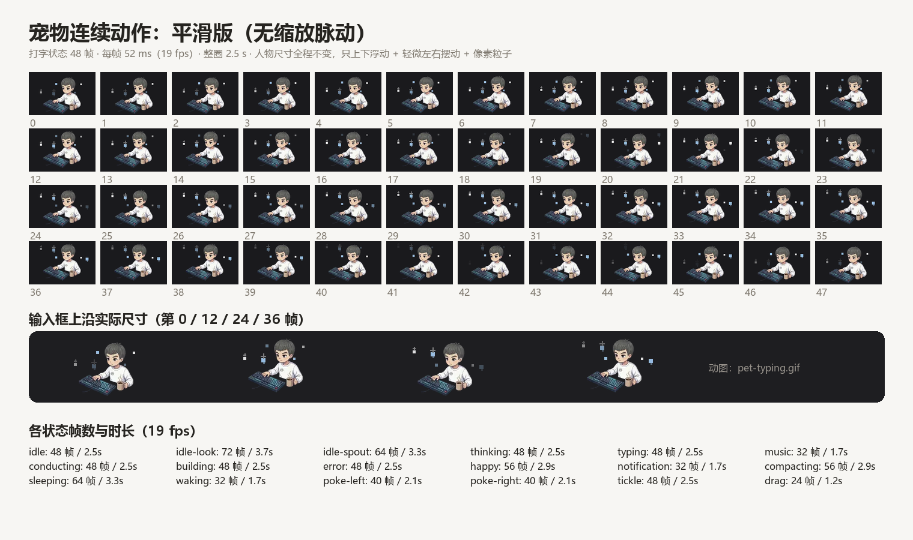

# dsh-linus-brand

把自己的插画角色装进 **DeepSeek Harness**（DSH）的 Web 界面：

- **侧栏品牌位** —— 左上角那个品牌标记，换成你的角色头像 + 名字；
- **输入框上沿的宠物** —— 把默认吉祥物（Deepy 鲸鱼）换成本角色的手绘形象，18 个状态各有 **24–72 帧连续动作**（≈19 fps），带像素粒子。



动图预览： [`docs/pet-typing.gif`](docs/pet-typing.gif) · 8 个姿势对照： [`docs/pet-states.png`](docs/pet-states.png) · 品牌位： [`docs/brand.png`](docs/brand.png)

---

## 它做了什么

| 位置 | 机制 |
| --- | --- |
| 侧栏 / 新会话页 / 账号头像的品牌图 | 把 `mark.png` 写入皮肤的图片品牌存储 `~/.dsh/dsh-claude-style/brand/mark.png`（存在则不动），皮肤自动把它用作品牌标记 |
| 品牌文字 | 皮肤配置 `brandName`，本包不强制改；建议设成你的名字 |
| 输入框上沿宠物 | Client 端按 `data-animation` 给每个状态注入一条 `!important` 规则，把 `--dsh-claude-mascot-sheet` 指向本包的 SVG 精灵条；尺寸/位置/换帧仍由皮肤自己驱动 |

也就是说：**没有替换皮肤的任何文件**，升级皮肤不会把你的界面改回去；关掉这个插件，界面立刻回到原样。

## 环境要求

1. DeepSeek Harness **≥ 0.2.2-rc.1**（本包在 0.2.2-rc.1 上开发与验证）
2. 皮肤插件 `dsh-claude-style`（Claude Style）
3. 皮肤设置里 **吉祥物 = Deepy**（`mascot: deepy`）。宠物条是按 Deepy 的格子尺寸做的，选 Clawd / 鲸娘 不会生效。品牌换图同样依赖这款皮肤的品牌图机制。

配置位置：`~/.dsh/profiles/<profile>/cordis.patch.yml` → `- id: ui-skin-claude-style` → `config:` 下

```yaml
    brandName: Linus     # 品牌文字（可选，但这就是“名字”那一行）
    mascot: deepy        # 必须是 deepy
```

## 安装

DSH 侧栏 → **插件** 页 → 安装框（"包名或地址"）里粘贴下面任意一种：

| 形式 | 粘贴内容 |
| --- | --- |
| GitHub 简写 | `github:AChengLinus/dsh-linus-brand` |
| GitHub 地址 | `https://github.com/AChengLinus/dsh-linus-brand` |
| Release 压缩包 | `https://github.com/AChengLinus/dsh-linus-brand/releases/download/v1.0.0/dsh-linus-brand-1.0.0.tgz` |
| 本地目录（绝对路径） | `D:\path\to\dsh-linus-brand` 或 `/Users/you/plugins/dsh-linus-brand` |
| npm 包名 | `dsh-linus-brand`（需先发布到 npm，见下） |

命令行等价写法：

```bash
dsh plugin add github:AChengLinus/dsh-linus-brand --profile desktop
```

安装完成后**重启一次应用**（没有 HMR 时，插件管理器会提示 `restart-required`）。然后打开 设置 → Claude Style，确认品牌图与吉祥物已经是你的角色。

> 从 zip 解压的目录直接当本地路径安装也可以：安装框要的是**绝对路径**，相对路径会被拒绝。

## 动画规格

- 精灵条：**8 列 × R 行**，每格一帧，共 `8 × R` 帧（24–72 帧）；
- 步进：皮肤每 **52 ms** 换一格 → **≈19 fps**；整圈 `8 × R × 52 ms`（1.2 s – 3.7 s）；
- 人物**不缩放**（每帧同一张贴图），只有上下浮动（7–9 栅格像素 ≈ 4.7–6 CSS px）与左右摆动（1–6 栅格像素）；
- 像素粒子按状态分 4 个主题色：`calm` 暖白、`work` 冷蓝、`play` 暖橙、`alert` 珊瑚；
- 状态切换时 sprite 用 280 ms 淡入 + 4 px 上移过渡，避免硬切。

18 个状态（由皮肤根据会话活动切换）→ 8 个姿势的映射：

| 姿势 | 用到的状态 |
| --- | --- |
| 笔记本 + 数位板 | `building` |
| 键盘打字 + 咖啡 | `typing` `drag` |
| 写笔记 | `thinking` `compacting` |
| 画架作画 | `conducting` `tickle` |
| 手柄游戏 | `music` `error` |
| 躺靠掌机 | `idle` `idle-look` `sleeping` `waking` |
| 手冲咖啡 | `idle-spout` `notification` |
| 喝茶 + 钓鱼竿 | `happy` `poke-left` `poke-right` |

## 想换成你自己的画

```bash
# 1) 把姿势 PNG（透明背景）放进 tools/poses/，文件名对应 build-sheets.py 里的 POSE 表
# 2) 重新生成精灵条（覆盖 assets/）
python3 tools/build-sheets.py

# 3) 把 client.js 里的 REV 改个值，避免浏览器继续用缓存
#    const REV = "anim4";  ->  const REV = "anim5";
# 4) 重启应用
```

`tools/build-sheets.py` 里三张表就是全部可调项：

- `DIMS`：每个状态的条带尺寸与行数（**必须和皮肤的格子几何一致**，改了要同步改 `index.js` 的 `STATES`/路由没问题，但尺寸必须对）；
- `MOTION`：每个状态的浮动幅度、摆动幅度、循环次数、粒子主题；
- `THEMES`：粒子颜色、数量、尺寸。

几何换算：皮肤的 1 逻辑像素 = 5 个 SVG 单位；CSS 尺寸 = 逻辑像素 × 2。所以一行格子的光栅尺寸取 `cell_w * 2 / 5 * 1.5`（1.5 是烘焙倍率，浏览器只缩小不放大，边缘更干净）。

## 卸载

- 插件页删除，或 `dsh plugin remove dsh-linus-brand --profile desktop`
- 品牌图：删除 `~/.dsh/dsh-claude-style/brand/mark.png`（皮肤的文件存储，本包不会自动清理）
- 宠物：卸载即恢复原图，无需其它操作

## 已知限制

- 依赖 `dsh-claude-style` 的类名（`.dsh-claude-deepy`、`data-animation`、`--dsh-claude-mascot-*`）。皮肤大改结构时本包需要跟着更新。
- 只在 `mascot: deepy` 下生效。
- 节奏由皮肤决定（52 ms/格）：想更慢只能减少独立帧数，或自己改皮肤的步进（本包不改皮肤）。
- 精灵条合计约 5.75 MB，安装后常驻在 profile 的 `node_modules` 里。

## English

`dsh-linus-brand` paints a custom character into two places of the DeepSeek Harness web UI: the sidebar brand mark (via the `dsh-claude-style` brand image store) and the composer pet (18 animation states, 24–72 distinct frames each, ~19 fps, pixel particles). It never rewrites the skin's files; uninstalling restores the stock look.

Install it from the Plugins page by pasting `github:AChengLinus/dsh-linus-brand`, the repository URL, the release tarball URL, or an absolute local path. Requires `dsh-claude-style` with `mascot: deepy`.

## License

MIT © AChengLinus

The artwork (poses, mark, icon) is a personal character illustration; the code and build script are free to reuse.
